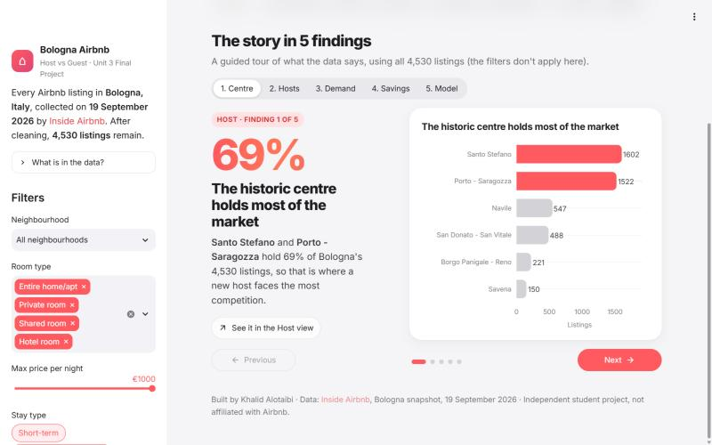
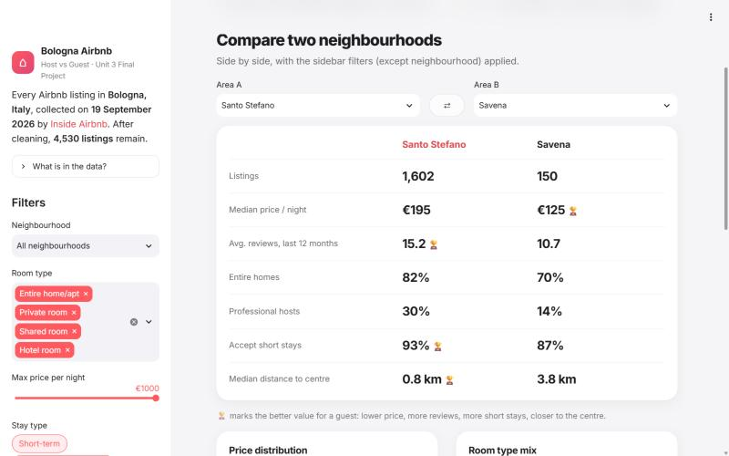

# Two sides of Bologna's Airbnb market

**Tuwaiq Academy · Unit 3 Final Project · Exploratory Data Analysis** by **Khalid Alotaibi**

This project explores every Airbnb listing in Bologna, Italy, on 19 September 2026 from two points of view.
**Hosts** want to know how to price and where they compete. **Guests** want to know what a night costs and
where to stay. The raw data (5,094 listings, 19 columns) is cleaned in a Python notebook, explored with
19 charts, and turned into an interactive Streamlit dashboard with a price model.

| | Link |
|---|---|
| Live dashboard | https://bologna-airbnb.streamlit.app |
| Presentation | https://xkh11.github.io/tuwaiq-academy-EDA-project/ |
| Dataset | [Inside Airbnb, Bologna, 19 Sep 2026](https://data.insideairbnb.com/italy/emilia-romagna/bologna/2026-09-19/visualisations/listings.csv) |

## Key findings

Demand is measured with reviews in the last 12 months, because the data has no booking numbers.

**For hosts**
1. **48 professional hosts run 28% of all listings.** They charge €31 more a night than single hosts, but single hosts get 35% more reviews.
2. **The mid-range gets the most demand.** Listings at €100 to €199 get a median of 10 reviews a year, budget listings only 3.
3. **Price hardly predicts demand** (correlation -0.09).

**For guests**

4. **A typical night costs €176** (median; the mean is €206 because of a few very expensive listings).
5. **A private room saves about €55 a night** (€134 against €189 for an entire home).
6. **Staying outside the centre saves about €70.** Savena has a median of €125, Santo Stefano €195. Still, 69% of listings are in the two central areas.

## Cleaning

| Step | Rows left |
|---|---|
| Raw file | 5,094 |
| Removed 2 duplicate listings | 5,092 |
| Removed 518 listings with no price | 4,574 |
| Removed 44 prices above €1,000 (max was €10,000) | **4,530** |

The notebook also drops 3 columns, fills missing review values, converts dates, renames 2 columns and adds
4 new ones (`host_type`, `has_license`, `price_category`, `stay_type`).

## The dashboard

| Story | Compare |
|---|---|
|  |  |

It has 8 views: **Story** (the findings one at a time), **Overview**, **Host**, **Guest** (with a map),
**Compare** (two neighbourhoods side by side), **Explore** (open any listing), **Predict** (a Random Forest
price model: €73 average error against €88 for guessing the median, R² 0.16) and **Data** (filtered table
and CSV download). The sidebar filters by neighbourhood, room type, max price and stay type.

## Run it locally

```bash
pip install -r app/requirements.txt
cd app
streamlit run app.py
```

Check every view without opening a browser:

```bash
python app/tests/smoke_test.py
```

The notebook runs in Google Colab or Jupyter. It loads the data straight from the Inside Airbnb link.

## Folder guide

```
├── notebook/bologna_airbnb_eda.ipynb   cleaning, EDA (19 charts), price model, insights
├── app/                                Streamlit dashboard (app.py, ui.py, data.py, model.py)
│   └── clean_listings.csv              the cleaned data the notebook produces
├── data/listings.csv                   the raw Inside Airbnb file
└── docs/                               the presentation (GitHub Pages) and speaker notes
```

## Tools

Python, pandas, NumPy, Matplotlib, Seaborn, scikit-learn, Plotly, Streamlit.

---

Built by **Khalid Alotaibi**. Data from [Inside Airbnb](https://insideairbnb.com/). Independent student project, not affiliated with Airbnb.
